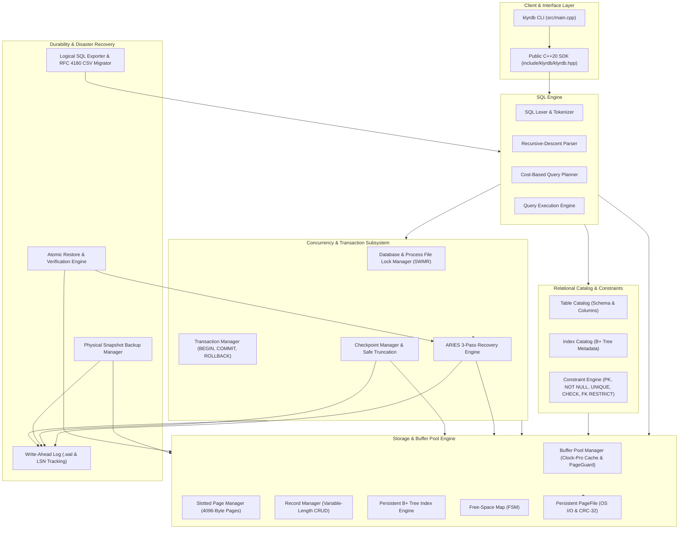

# KlyrDB

A persistent, embedded SQL relational database engine implemented from scratch in standard ISO C++20, featuring fixed 4096-byte slotted-page storage, B+ tree indexing, ARIES-style crash recovery, a cost-based query planner, relational constraints, physical snapshot backup & atomic restore, and a modern C++ developer SDK.

> [!WARNING]
> **Pre-1.0 Experimental Engine:** KlyrDB is an educational systems-programming project and experimental database engine designed for research, architecture study, and embedded exploration. It is **not** certified for mission-critical enterprise production deployments, and no claims of commercial ACID certification or universal fault tolerance are made.

---

## Architecture

KlyrDB follows a layered, modular architecture inspired by classical database systems engineering:



---

## Core Capabilities by Subsystem

### 1. Storage & Page Architecture
- **Fixed 4096-Byte Pages:** Big-endian binary page format with 24-byte headers, monotonic page LSNs, and IEEE 802.3 32-bit CRC-32 integrity validation.
- **Slotted-Page Tuple Management:** Variable-length records with slotted-page directory indirection, slot compaction, and persistent `[page_id:slot_id]` record identifiers (`RecordId`).
- **Clock-Pro Buffer Pool:** Configurable in-memory frame cache with clock eviction policy, dirty-frame tracking, and RAII pinned `PageGuard` handles.
- **Free-Space Map (FSM):** Bitmap/byte-level capacity indexing allowing efficient $O(1)$ page allocation for record insertion.

### 2. SQL Grammar & Execution
- **Data Definition Language (DDL):** `CREATE TABLE`, `DROP TABLE`, `CREATE [UNIQUE] INDEX`, `DROP INDEX`.
- **Data Manipulation Language (DML):** `INSERT INTO`, `SELECT` (with column projection, `WHERE` predicates, `ORDER BY`, and `LIMIT`), `UPDATE` (scoped `WHERE` required for safety), and `DELETE`.
- **Relational Constraints:** Single-column `PRIMARY KEY`, `NOT NULL`, column-level and table-level `UNIQUE`, `CHECK` boolean expressions, and `FOREIGN KEY ... REFERENCES` with `RESTRICT` on delete/update.
- **First-Class NULL Semantics:** SQL three-valued logic; explicit distinction between `NULL`, empty string (`""`), and integer `0`; standard SQL multi-null semantics in unique indexes.

### 3. Transactions & Crash Recovery
- **Single-Writer / Multi-Reader (SWMR):** Shared/exclusive database locking complemented by operating-system advisory file locking (`.lock`) preventing concurrent process interference.
- **Write-Ahead Logging (WAL):** Dedicated companion log file (`<dbname>.wal`) enforcing the Write-Ahead Rule (log flushed before dirty page eviction).
- **Multi-Page Rollback:** In-memory before-image capture with reverse-order undo across complex multi-page modifications.
- **ARIES-Style 3-Pass Recovery:** Restartable Analysis, Redo, and Undo passes; generates durable `Abort` records to guarantee recovery idempotence.
- **Safe Checkpointing & Log Truncation:** Active transaction tracking identifies safe recovery horizons, flushes dirty pages, syncs Page 0 checkpoint LSN, and atomically truncates obsolete WAL records.

### 4. Indexing & Cost-Based Query Planning
- **Persistent B+ Tree Indexes:** Balanced tree storage supporting 64-bit integer and text keys up to 256 bytes, dynamic page split/merge balancing, and forward/reverse sequential leaf iteration.
- **Cost-Based Query Planner:** Evaluates physical access paths (`TableScan`, `IndexSeek`, `IndexRangeScan`) against calibrated I/O and CPU cost formulas.
- **Plan Optimizations:** Multi-condition range consolidation, residual filter pushdown, index-assisted `ORDER BY` sort elimination, early-exit `LIMIT` pushdown, and unselective index fallback.
- **Execution Profiling (`EXPLAIN` & `EXPLAIN ANALYZE`):** Read-only inspection of physical query plans and runtime execution profiling with microsecond timing and rows examined telemetry.

### 5. Reliability, Diagnostics & Disaster Recovery
- **Physical Snapshot Backup (`BackupManager`):** Coordinated online snapshot backups generating standalone directories containing verified `manifest.json`, component file CRC-32 checksums, and flushed data/log state.
- **Atomic Disaster Restore (`RestoreManager`):** Pre-restore integrity audit, non-destructive staging recovery replay, and atomic directory swap preventing partial-restore database corruption.
- **Storage Integrity Verification (`IntegrityChecker`):** Multi-layer offline/online audit validating page CRC-32 checksums, slotted-page directory integrity, B+ tree key ordering, and foreign key referential consistency.
- **Data Migration:** RFC 4180 CSV export/import with explicit `\N` null fidelity; topological DAG-ordered logical SQL schema and data export/import.
- **Runtime Observability:** Zero disk-overhead atomic metric registry tracking buffer pool hits, query durations, lock contention, and recovery operations with JSON export.

### 6. Developer API & SDK
- **Modern C++20 Interface:** Unified public umbrella header `<klyrdb/klyrdb.hpp>` exporting RAII `Database`, `Connection`, `ResultSet`, and `TransactionGuard` abstractions.
- **Modern CMake Packaging:** Standard `find_package(KlyrDB REQUIRED)` integration exporting `KlyrDB::KlyrDB` target with zero external dependencies.

---

## Known Architecture & Engine Limitations

To maintain technical integrity, external evaluators and developers should note the current engine constraints:

| Subsystem | Verified Capability | Architectural Limitation |
|---|---|---|
| **Concurrency** | Concurrent multi-threaded and multi-process readers via shared locking | Single active writer (SWMR); mutations acquire coarse-grained exclusive database locks |
| **Record Size** | Slotted-page variable-length storage | Maximum tuple payload is 4,072 bytes; no multi-page overflow pages (TOAST) |
| **SQL Engine** | `SELECT`, `INSERT`, `UPDATE`, `DELETE`, `WHERE`, `ORDER BY`, `LIMIT` | No `JOIN` operations, no subqueries, no `GROUP BY`/`HAVING`, no window functions |
| **Aggregations** | Result set row counts via `ResultSet::row_count()` | No SQL query expression aggregates (`COUNT(*)`, `SUM()`, `AVG()`, `MIN()`, `MAX()`) |
| **Schema Evolution** | `CREATE TABLE`, `DROP TABLE`, `CREATE INDEX`, `DROP INDEX` | No `ALTER TABLE` schema mutations |
| **Indexing** | Single-column integer (`int64_t`) and text (`std::string`) keys | No composite / multi-column index keys |
| **Deployment** | Embedded library and standalone local CLI utility | No background TCP/IP server daemon or client-server network protocol |

---

## Building and Testing

### Prerequisites
- Modern ISO C++20 compiler:
  - Microsoft Visual Studio 2022 / 2026 (MSVC 19.51+)
  - Clang 15+
  - GCC 12+
- CMake 3.20 or newer

### 1. Configure and Build

```powershell
# Configure build directory (Release mode)
cmake -B build -S . -DCMAKE_BUILD_TYPE=Release

# Build database engine library, CLI, and test targets
cmake --build build --config Release
```

### 2. Run Test Suite (51 / 51 Passing)

```powershell
# Execute all 51 automated CTest test suites
ctest --test-dir build -C Release --output-on-failure
```

### Verified Test Suite Breakdown (100% Pass Rate)

| Test Category | Target Count | Covered Subsystems |
|---|---|---|
| **Storage & Buffer Pool** | 9 Suites | Page serialization, CRC-32, PageFile boundaries, Clock-Pro cache eviction, SlottedPage compaction, RecordManager CRUD, B+ tree splits/merges, Free-Space Map. |
| **SQL Engine & Parsing** | 4 Suites | Lexical analysis, recursive-descent AST parser, table catalog persistence, SQL execution and constraints. |
| **Transactions & WAL** | 6 Suites | Monotonic LSNs, hardware flushes, multi-page rollback, 3-pass ARIES recovery, 10 deterministic crash-injection scenarios, multi-row atomicity. |
| **Query Planner & EXPLAIN** | 4 Suites | Cost-based access path selection, range consolidation, residual filter pushdown, ORDER BY elimination, LIMIT pushdown, EXPLAIN ANALYZE. |
| **Concurrency & Locking** | 6 Suites | Shared/exclusive table locks, process `.lock` mutual exclusion, multi-threaded buffer pool concurrency, read scaling, write isolation, dirty read avoidance. |
| **Checkpoint & Integrity** | 6 Suites | Safe checkpoint horizons, active transaction retention, atomic WAL truncation, multi-layer integrity checker, storage corruption detection, lifecycle stress. |
| **Backup, Restore & Migration** | 8 Suites | Physical snapshot backups, standalone non-destructive verifier, bit-level corruption rejection, atomic staging restore, DAG SQL export, RFC 4180 CSV migration. |
| **Observability & Fuzzing** | 5 Suites | Atomic metrics registry, query execution profiling, property-based randomized transactions, parser mutation fuzzing, multi-threaded stress testing. |
| **Release & Public SDK** | 3 Suites | Public C++20 SDK (`test_public_api`), CLI smoke workflow (`test_cli_smoke`), adversarial corruption & recovery idempotence (`test_adversarial`). |

---

## Quick-Start: Interactive CLI

The compiled database CLI (`klyrdb.exe`) provides direct query execution, interactive shell sessions, maintenance operations, and disaster recovery:

```powershell
# 1. Launch interactive SQL shell (or create new database)
.\build\Release\klyrdb.exe sql mydb.kdb

# 2. Execute direct SQL statements from the command line
.\build\Release\klyrdb.exe sql mydb.kdb "CREATE TABLE users (id INTEGER PRIMARY KEY, name TEXT NOT NULL, email TEXT UNIQUE);"
.\build\Release\klyrdb.exe sql mydb.kdb "INSERT INTO users VALUES (1, 'Ada Lovelace', 'ada@example.com');"
.\build\Release\klyrdb.exe sql mydb.kdb "INSERT INTO users VALUES (2, 'Alan Turing', 'alan@example.com');"
.\build\Release\klyrdb.exe sql mydb.kdb "SELECT id, name, email FROM users WHERE id >= 1 ORDER BY id ASC;"

# 3. Inspect physical storage and relational integrity
.\build\Release\klyrdb.exe integrity-check mydb.kdb

# 4. Perform safe checkpoint and WAL truncation
.\build\Release\klyrdb.exe checkpoint mydb.kdb

# 5. Create verified physical snapshot backup
.\build\Release\klyrdb.exe backup mydb.kdb backups/snapshot_01

# 6. Verify backup integrity without restoring
.\build\Release\klyrdb.exe backup-verify backups/snapshot_01

# 7. Atomically restore backup to a new database
.\build\Release\klyrdb.exe restore backups/snapshot_01 restored_db.kdb
```

---

## Quick-Start: C++20 SDK Public API

KlyrDB provides a public C++20 API via `#include <klyrdb/klyrdb.hpp>`. The example below demonstrates database initialization, transactional mutation with RAII rollback safety, and result iteration:

```cpp
#include <klyrdb/klyrdb.hpp>
#include <iostream>

int main() {
    // 1. Open database (creates file if not present)
    auto db_res = klyrdb::Database::open("app.kdb");
    if (!db_res.is_ok()) {
        std::cerr << "Open failed: " << db_res.status().message() << "\n";
        return 1;
    }
    auto db = std::move(db_res.value());

    // 2. Establish connection session
    auto conn_res = db->connect();
    if (!conn_res.is_ok()) {
        std::cerr << "Connect failed: " << conn_res.status().message() << "\n";
        return 1;
    }
    auto conn = std::move(conn_res.value());

    // 3. Define schema
    conn->execute("CREATE TABLE products (sku INTEGER PRIMARY KEY, name TEXT, price INTEGER);");

    // 4. Transactional insert with RAII TransactionGuard
    {
        klyrdb::TransactionGuard txn(*conn);
        conn->execute("INSERT INTO products VALUES (101, 'Mechanical Keyboard', 89);");
        conn->execute("INSERT INTO products VALUES (102, 'Optical Mouse', 39);");
        
        // Explicit commit; if an exception or return occurs before this, changes roll back
        txn.commit();
    }

    // 5. Query execution and tabular result iteration
    auto res = conn->execute("SELECT sku, name, price FROM products WHERE price < 50 ORDER BY sku ASC;");
    if (res.is_ok()) {
        const auto& result_set = res.value();
        std::cout << "Matching products (" << result_set.row_count() << "):\n";
        for (const auto& row : result_set) {
            std::cout << "  - [" << row["sku"].as_integer() << "] "
                      << row["name"].as_text() << " : $"
                      << row["price"].as_integer() << "\n";
        }
    }

    db->close();
    return 0;
}
```

---

## Integrating via CMake

Installations of KlyrDB export standard CMake package files (`KlyrDBConfig.cmake`).

### Consumer `CMakeLists.txt`
```cmake
cmake_minimum_required(VERSION 3.20)
project(my_klyrdb_app LANGUAGES CXX)

set(CMAKE_CXX_STANDARD 20)
set(CMAKE_CXX_STANDARD_REQUIRED ON)
set(CMAKE_CXX_EXTENSIONS OFF)

# Locate installed KlyrDB package
find_package(KlyrDB REQUIRED)

# Link against the exported interface
add_executable(my_klyrdb_app main.cpp)
target_link_libraries(my_klyrdb_app PRIVATE KlyrDB::KlyrDB)
```

### Configuring Consumer Applications
If KlyrDB was unpacked or installed to a custom location, specify `CMAKE_PREFIX_PATH`:
```powershell
cmake -B build -S . -DCMAKE_PREFIX_PATH="C:/opt/klyrdb" -DCMAKE_BUILD_TYPE=Release
cmake --build build --config Release
```

---

## Empirical Performance Benchmarks

The benchmark suite (`benchmarks/benchmark_reliability.cpp`) executes against persistent disk storage with active WAL logging. Durations are measured using `std::chrono::steady_clock`.

### Reproduction Command
```powershell
.\build\Release\benchmark_reliability.exe
```

### Measured Performance Profile

| Workload Operation | Sample Size | Throughput (ops/sec) | P50 Latency | P95 Latency | P99 Latency | Buffer Hit % |
|---|---|---|---|---|---|---|
| **Sequential Inserts** | 1,000 txns | ~630 – 680 | $1.28\text{ ms}$ | $2.65\text{ ms}$ | $4.21\text{ ms}$ | 99.41% |
| **PK Point Seeks** | 1,000 queries | ~815 – 885 | $0.91\text{ ms}$ | $1.91\text{ ms}$ | $2.91\text{ ms}$ | 99.92% |
| **Index Range Scans** | 500 scans | ~420 – 480 | $1.78\text{ ms}$ | $3.48\text{ ms}$ | $4.00\text{ ms}$ | 99.95% |
| **Point Updates** | 1,000 txns | ~500 – 640 | $1.43\text{ ms}$ | $2.59\text{ ms}$ | $3.63\text{ ms}$ | 99.95% |
| **Full Table ANALYZE** | Complete scan | — | $18.57\text{ ms}$ | — | — | 100.0% |

> [!NOTE]
> **Methodology & Reproduction Caveats:** Measurements were gathered on Windows 11 x64, MSVC 19.51, using a 64-frame buffer pool cache on a local NVMe SSD. In un-optimized Debug builds, median latency is slightly higher due to runtime assertions. Throughput includes full slotted-page tuple serialization, B+ tree leaf traversal, page latching, and WAL record generation.

---

## Platform & Compiler Support

| Platform / Operating System | Compiler Toolchain | Verification Status | Notes |
|---|---|---|---|
| **Windows 11 x64** | MSVC 19.51 (Visual Studio 2022/2026 BuildTools) | **Tested & Verified** | Primary release target. Uses `LockFileEx` for process exclusivity and `FlushFileBuffers` for hardware synchronization. |
| **Linux x64 (Ubuntu 22.04 LTS)** | GCC 12+ / Clang 15+ | **Portable / Intended** | Pure ISO C++20 codebase using POSIX `fcntl` and `fsync`. Validated in CI workflow (`.github/workflows/ci.yml`). |

---

## Release Verification & Distribution

Pre-built Windows x64 distribution packages are verified for external consumer compilation:

- **Release Archive:** `dist/klyrdb-0.12.0-windows-x64.zip`
- **Expected SHA-256:** `58CF6568E9FB5DF8B37A865651A5E99218EDE451F3A9523689878DD4A1242DEA`
- **Verification Report:** [docs/phase-13b-release-verification.md](docs/phase-13b-release-verification.md)
- **Historical Audit:** [docs/phase-13a-release-verification.md](docs/phase-13a-release-verification.md)
- **Release Notes:** [docs/release-notes-v0.12.0.md](docs/release-notes-v0.12.0.md)

### Verifying Checksum (PowerShell)
```powershell
Get-FileHash -Path dist\klyrdb-0.12.0-windows-x64.zip -Algorithm SHA256
```

### Verifying Checksum (Linux / bash)
```bash
sha256sum -c dist/klyrdb-0.12.0-windows-x64.zip.sha256
```

---

## Documentation Index

Detailed architectural specifications, subsystem designs, and verification reports are available in the [`docs/`](docs/) directory:

- **Storage & Architecture:**
  - [Architecture Overview](docs/architecture.md) — System layer breakdown and dependency flow.
  - [Storage Format Specification](docs/storage-format.md) — Binary page headers, magic signatures, and geometry.
  - [Slotted Pages](docs/slotted-pages.md) — Slotted page format, slot arrays, and compaction.
  - [Buffer Pool Manager](docs/buffer-pool.md) — Clock-Pro replacement policy and RAII PageGuard design.
  - [Record Manager](docs/record-manager.md) — Variable-length tuple serialization and RecordId lifecycle.
  - [Free-Space Map](docs/free-space-map.md) — Page capacity tracking and allocation mechanics.
  - [B+ Tree Indexing](docs/bplus-tree.md) — Persistent B+ tree node format, split/merge logic, and iterators.
- **Relational Engine & SQL:**
  - [SQL Engine](docs/sql-engine.md) — Lexer, AST nodes, recursive-descent parser, and execution dispatch.
  - [Table Catalog](docs/table-catalog.md) — Persistent schema catalogs and column metadata.
  - [Constraints](docs/constraints.md) — Primary key, foreign key, unique, check, and null semantics.
  - [Query Planner](docs/query-planner.md) — Cost model formulas, access paths, and optimization rules.
  - [Query Profiling & EXPLAIN](docs/explain.md) — `EXPLAIN` and `EXPLAIN ANALYZE` syntax and execution profiling.
- **Transactions, WAL & Durability:**
  - [Transactions](docs/transactions.md) — ACID state machines, before-image logging, and rollback mechanics.
  - [Write-Ahead Logging](docs/wal.md) — WAL record format, monotonic LSN sequencing, and CRC validation.
  - [Crash Recovery](docs/recovery.md) — ARIES 3-pass recovery, analysis horizon, redo, and undo passes.
  - [Checkpointing](docs/checkpointing.md) — Safe checkpoint boundaries, dirty page flushes, and WAL truncation.
  - [Integrity Checking](docs/integrity-check.md) — Non-destructive storage and relational validation checks.
- **Disaster Recovery & Data Migration:**
  - [Physical Backup](docs/physical-backup.md) — Coordinated snapshot backup mechanics and locking.
  - [Disaster Restore](docs/restore.md) — Atomic staging restore, validation, and directory swapping.
  - [Backup Format](docs/backup-format.md) — `manifest.json` schema and component checksum verification.
  - [Logical Export & Import](docs/logical-export-import.md) — DAG topological SQL export and RFC 4180 CSV migration.
- **Developer Guide & Release Engineering:**
  - [Public C++ API Reference](docs/public-api.md) — Detailed guide to `<klyrdb/klyrdb.hpp>` classes.
  - [CMake Integration](docs/cmake-integration.md) — Downstream consumer integration instructions.
  - [Building from Source](docs/building.md) — Compiler setup, presets, and platform requirements.
  - [Known Limitations](docs/known-limitations.md) — Explicit engine boundaries and unsupported SQL features.
  - [Release Notes v0.12.0](docs/release-notes-v0.12.0.md) — Release Candidate v0.12.0 changelog and verified assets.

---

## License

No open-source license is currently assigned to this repository. For inquiries regarding licensing, evaluation, or educational use, please contact the repository maintainer.
