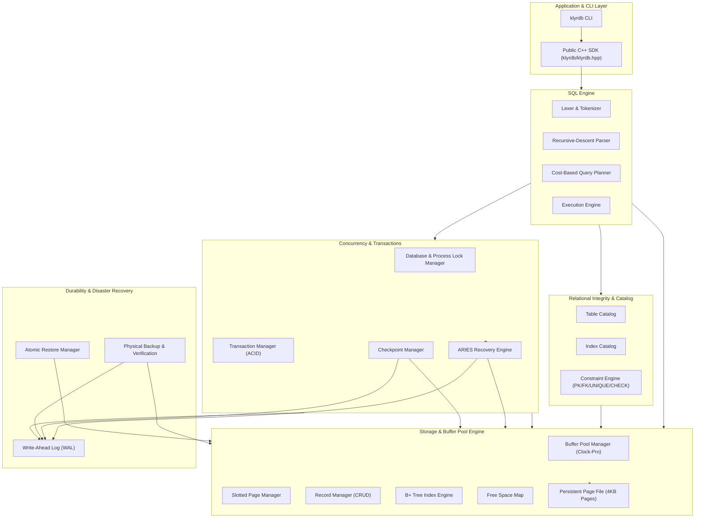

# KlyrDB — C++20 Relational Database Engine

**KlyrDB** is an embedded relational database engine implemented from scratch in modern standard C++20, inspired by SQLite's layered architecture. It features persistent slotted-page storage, a Clock-Pro buffer pool, B+ tree indexing, an ARIES-style Write-Ahead Logging (WAL) recovery manager, a cost-based query planner, relational constraints, process-level concurrency control, physical hot backup & atomic restore, and a modern C++ developer SDK.

- **Phase 1**: Core Storage Foundation (Fixed 4096-byte pages, Big-Endian binary format, CRC-32 integrity validation, PageFile persistence).
- **Phase 2**: Buffer Pool, Slotted Pages & Record Manager (Clock replacement cache, PageGuard RAII, variable-length slotted pages, multi-page record CRUD, persistent RecordIds).
- **Phase 3**: B+ Tree Indexing & Free-Space Map (Persistent balanced B+ tree index, dynamic node splits/merges, duplicate key support, sequential range iterator, persistent Index Catalog, and Free-Space Map).
- **Phase 4**: SQL Language, Table Catalog & Query Execution (Persistent schema catalog, portable multi-table row codec, SQL Lexer, recursive-descent parser, query execution engine with B+ tree index acceleration, in-memory sorting, safety guards, and interactive SQL shell).
- **Phase 5**: Write-Ahead Logging, Transactions & Crash Recovery (Persistent WAL `<dbname>.wal`, LSN tracking, Write-Ahead Rule enforcement, single-writer transaction model, multi-page reverse rollback, restartable 3-pass crash recovery, and 9 deterministic crash-injection scenarios).
- **Phase 6**: Schema Constraints & Relational Integrity (`NOT NULL`, single-column `PRIMARY KEY`, single-column `UNIQUE`, and `FOREIGN KEY` with `RESTRICT`/`NO ACTION` referential integrity, backing unique B+ tree index synchronization, DDL/index protection, typed `NULL` support, multi-row atomicity, and backward compatibility).
- **Phase 7**: Query Planning, Optimization & EXPLAIN (Cost-based query planner, physical access paths: Table Scan vs Index Seek vs Index Range Scan, cost estimation with unselective scan detection, multi-predicate conjunctions + residual filters, index-assisted ORDER BY elimination, early-exit LIMIT pushdown, and `EXPLAIN [QUERY PLAN]` inspection).
- **Phase 8**: Concurrency Control, Locking & Database Hardening (Process file locking, shared-exclusive table & database concurrency guards, thread-safe buffer pool and page latching, multi-threaded reader-writer scaling, deadlock avoidance via ordered lock acquisition, and isolation hardening).
- **Phase 9**: Checkpointing, WAL Lifecycle Management & Storage Reliability (Active transaction tracking, safe checkpoint boundary computation, atomic WAL truncation and space reclamation, optimized startup recovery from verified checkpoints, read-only storage and relational integrity verification subsystem, CLI operations, and crash simulation across 10 failure points).
- **Phase 10**: Physical Backup, Atomic Restore, Logical Export/Import & Disaster Recovery (Physical snapshot backups with versioned `manifest.json` and CRC-32 bit-level checksums, standalone non-destructive `BackupVerifier`, transactional `RestoreManager` with pre-restore validation and atomic staging file swap, topological DAG-ordered logical SQL export/import, RFC 4180 CSV export/import with explicit NULL (`\N`) fidelity, 7 new CLI subcommands, 43/43 passing test suites, and empirical benchmarks).
- **Phase 11**: Observability, Query Profiling, Fuzz Testing & Reliability Engineering (Thread-safe atomic metrics subsystem with zero critical-path disk overhead, `DatabaseMetricsRegistry`, human-readable and RFC 8259 JSON reporting, `EXPLAIN ANALYZE` with microsecond-resolution execution profiling and rows examined tracking, `TableStatisticsRegistry` and `ANALYZE` for distribution caching, property-based randomized transactions, SQL parser mutation fuzzing, multi-threaded reader-writer stress testing, 5 new test suites with 48/48 (100%) passing CTest targets, and reproducible OLTP benchmarks).
- **Phase 12**: Release Engineering, Stable C++ API, Packaging & Developer SDK (Unified public C++20 developer interface via `<klyrdb/klyrdb.hpp>`, RAII `Database`, `Connection`, `ResultSet`, and `TransactionGuard`, CMake package config and `KlyrDB::KlyrDB` exported targets, reproducible Release packaging scripts, external standalone consumer examples, 50/50 passing CTest targets, and comprehensive developer documentation).
- **Phase 13**: Adversarial Audit, Release Candidate & Portfolio Launch (Adversarial edge testing, malformed WAL record detection, ARIES recovery idempotence hardening via durable Abort records, Page 0 checkpoint LSN synchronization, standard SQL null semantics in unique indexes, 51/51 passing CTest suites, known limitations specification, and verified Windows x64 release distribution).

---

## Architecture



---

## System Capabilities & Limitations

| Capability | Supported Specification | Documented Limitation |
|---|---|---|
| **Storage Architecture** | Fixed 4096-byte slotted pages, IEEE CRC-32 checksums | Single tuple max 4072 bytes (no overflow pages) |
| **Indexing** | B+ Tree with integer & string single-column keys | No composite/multi-column indexes |
| **SQL Engine** | `CREATE TABLE`, `DROP TABLE`, `CREATE INDEX`, `DROP INDEX`, `INSERT`, `SELECT`, `UPDATE`, `DELETE`, `EXPLAIN` | No `JOIN`, `GROUP BY`, `HAVING`, or window functions |
| **Transactions** | Strict 2-Phase Locking (Single-Writer / Multi-Reader), Write-Ahead Logging, Rollbacks | Coarse-grained exclusive write locks |
| **Crash Safety** | ARIES-style redo/undo recovery with checkpoint acceleration | Requires companion WAL file (`.wal`) |
| **Data Migration** | RFC 4180 CSV export/import (`\N` nulls), Topological SQL dump | CSV import requires pre-created table schema |
| **Deployment** | Embedded library (`KlyrDB::KlyrDB`) and interactive CLI (`klyrdb`) | No network server / TCP protocol daemon |


---

## Architecture Overview

```text
KlyrDB/
├── CMakeLists.txt              # Root build configuration
├── CMakePresets.json           # Presets for standard and debug builds
├── README.md                   # Project documentation
├── .gitignore                  # Git ignore rules
├── docs/                       # Technical & architectural specifications
│   ├── architecture.md         # Subsystem architecture & dependency chain
│   ├── storage-format.md       # On-disk binary format specification
│   ├── constraints.md          # Schema constraints & relational integrity specification
│   ├── wal.md                  # Write-Ahead Log format & LSN mechanics
│   ├── transactions.md         # Transaction states, before-images & rollback
│   ├── recovery.md             # ARIES-style 3-pass recovery algorithm
│   ├── table-catalog.md        # Persistent schema catalog & multi-table format
│   ├── sql-engine.md           # SQL parser, AST, executor & index selection
│   ├── query-planner.md        # Cost-based query planner, cost formulas & access paths
│   ├── explain.md              # EXPLAIN & EXPLAIN QUERY PLAN syntax & formats
│   ├── buffer-pool.md          # Buffer pool, Clock replacer & PageGuard design
│   ├── slotted-pages.md        # Slotted page binary format & compaction
│   ├── record-manager.md       # RecordManager & RecordId semantics
│   ├── bplus-tree.md           # B+ tree indexing engine & node layouts
│   ├── free-space-map.md       # Free-Space Map architecture & capacity rules
│   ├── checkpointing.md        # Safe checkpointing protocol, boundaries & truncation
│   ├── integrity-check.md      # Read-only storage & relational integrity verification
│   ├── phase-1-testing.md      # Phase 1 test coverage matrix
│   ├── phase-2-testing.md      # Phase 2 test coverage matrix
│   ├── phase-3-testing.md      # Phase 3 test matrix & empirical benchmarks
│   ├── phase-4-testing.md      # Phase 4 test report & verification
│   ├── phase-5-testing.md      # Phase 5 test report & crash matrix
│   ├── phase-6-testing.md      # Phase 6 test report & constraints verification
│   ├── phase-7-testing.md      # Phase 7 test report & optimizer benchmarks
│   ├── phase-8-preflight-audit.md # Phase 8 concurrency audit
│   ├── physical-backup.md      # Physical snapshot backup, locking & atomic publication
│   ├── restore.md              # Atomic disaster recovery, staging swap & verification
│   ├── logical-export-import.md # DAG topological SQL export & RFC 4180 CSV migration
│   ├── backup-format.md        # Backup manifest.json schema & component records
│   ├── phase-10-preflight-audit.md # Phase 10 preflight audit
│   └── phase-10-testing.md     # Phase 10 test report (43 suites) & benchmarks
├── include/klyrdb/
│   ├── common/                 # Core utilities
│   │   ├── types.hpp           # Primitives (page_id_t, slot_id_t, lsn_t, PageType)
│   │   ├── status.hpp          # Rich status codes and diagnostics
│   │   ├── result.hpp          # Monadic Result<T> container
│   │   ├── endian.hpp          # Portable Big-Endian bit-shifters
│   │   └── checksum.hpp        # CRC-32 (IEEE 802.3) table implementation
│   ├── storage/                # Storage, Caching, & Space Management
│   │   ├── page_constants.hpp  # Offsets, signatures, page sizes
│   │   ├── page_header.hpp     # 24-byte page header representation (with page_lsn)
│   │   ├── page.hpp            # 4096-byte page abstraction & serialization
│   │   ├── page_file.hpp       # RAII database file manager with hardware sync
│   │   ├── metadata_page.hpp   # Page 0 database header & system metadata
│   │   ├── buffer_pool_manager.hpp # Clock-replacer buffer pool manager with WAL sync
│   │   ├── page_guard.hpp      # RAII pinned page guard
│   │   ├── slotted_page.hpp    # Slotted page for variable-length records
│   │   ├── record_id.hpp       # Persistent [page_id:slot_id] identifier
│   │   ├── record_manager.hpp  # Multi-page record CRUD manager
│   │   ├── record.hpp          # Versioned, typed tuple serialization
│   │   ├── free_space_map.hpp  # Persistent Free-Space Map (FSM)
│   │   └── integrity_checker.hpp # Multi-layer storage & constraint integrity auditor
│   ├── index/                  # B+ Tree Indexing Engine
│   │   ├── key.hpp             # Strongly-typed IndexKey & IndexEntry
│   │   ├── bplus_tree_node.hpp # Page-backed B+ tree node operator
│   │   ├── bplus_tree.hpp      # Persistent B+ Tree & BPlusTreeIterator
│   │   └── index_catalog.hpp   # Persistent Index Catalog
│   ├── catalog/                # Relational Schema Management
│   │   └── table_catalog.hpp   # Persistent Table Catalog (PageType::TableCatalog)
│   ├── wal/                    # Write-Ahead Logging
│   │   ├── log_record.hpp      # Binary WAL record format (25B header + images + CRC)
│   │   └── write_ahead_log.hpp # Persistent WAL manager & durable flushes
│   ├── txn/                    # Transaction Engine
│   │   ├── transaction.hpp     # Transaction state & page change history
│   │   └── transaction_manager.hpp # BEGIN, COMMIT, multi-page ROLLBACK
│   ├── recovery/               # Crash Recovery Engine
│   │   ├── recovery_manager.hpp # 3-pass restartable crash recovery
│   │   ├── checkpoint_manager.hpp # Safe & passive checkpoint protocol
│   │   └── crash_simulator.hpp  # 10 deterministic crash-injection points
│   └── sql/                    # SQL Engine Subsystem
│       ├── value.hpp           # SqlValue (Integer, Text) & conversions
│       ├── row.hpp             # Portable row serialization with table_id
│       ├── token.hpp           # SQL Token definitions
│       ├── lexer.hpp           # Tokenizer with case-insensitivity & escapes
│       ├── ast.hpp             # Abstract Syntax Tree nodes (includes BEGIN/COMMIT/ROLLBACK)
│       ├── parser.hpp          # Recursive-descent SQL parser
│       ├── query_plan.hpp      # QueryPlan, AccessPathType & PlanCost models
│       ├── query_planner.hpp   # Cost-based QueryPlanner engine
│       ├── query_result.hpp    # Tabular query results & ASCII table renderer
│       ├── executor.hpp        # Query executor with transaction integration
│       └── sql_shell.hpp       # Interactive SQL REPL & dot commands
├── src/
│   ├── common/                 # Common implementations
│   ├── storage/                # Storage engine implementations
│   ├── index/                  # Index engine implementations
│   ├── catalog/                # Table catalog implementation
│   ├── wal/                    # WAL implementations
│   ├── txn/                    # Transaction implementations
│   ├── recovery/               # Recovery implementations
│   ├── sql/                    # SQL engine implementations
│   ├── backup/                 # Phase 10 Backup, Restore & Migration engines
│   └── main.cpp                # CLI database utility tool
├── benchmarks/
│   ├── benchmark_index.cpp     # Point lookup, range scan & FSM benchmark
│   ├── benchmark_query_optimizer.cpp # Cost-based optimizer speedup benchmark
│   ├── benchmark_concurrency.cpp # Multi-threaded reader/writer benchmark
│   ├── benchmark_wal_lifecycle.cpp # Phase 9 WAL lifecycle & checkpoint benchmark
│   └── benchmark_backup_restore.cpp # Phase 10 Backup, Restore & Migration benchmark
├── examples/
│   ├── storage_demo.cpp        # Standalone Phase 3 storage demonstration
│   ├── sql_demo.cpp            # Standalone Phase 4 SQL engine demonstration
│   ├── wal_demo.cpp            # Standalone Phase 5 WAL, txn & recovery demonstration
│   └── constraints_demo.cpp    # Standalone Phase 6 relational constraints demonstration
└── tests/
    ├── CMakeLists.txt          # Test runner configuration (43 suites)
    ├── test_framework.hpp      # Lightweight hermetic test harness
    ├── test_page.cpp           # Page serialization & checksum unit tests
    ├── test_page_file.cpp      # File management & boundary tests
    ├── test_persistence.cpp    # End-to-end multi-page & corruption tests
    ├── test_buffer_pool.cpp    # Buffer pool & Clock eviction unit tests
    ├── test_slotted_page.cpp   # Slotted page & compaction unit tests
    ├── test_record_manager.cpp # Multi-page record manager integration tests
    ├── test_bplus_tree.cpp     # B+ tree splits, merges, duplicates, iterators
    ├── test_fsm.cpp            # Free-Space Map unit & persistence tests
    ├── test_index_integration.cpp # End-to-end index + FSM + buffer pressure tests
    ├── test_sql_lexer.cpp      # SQL lexical analyzer unit tests
    ├── test_sql_parser.cpp     # SQL AST and parser unit tests
    ├── test_table_catalog.cpp  # Table schema catalog persistence tests
    ├── test_sql_executor.cpp   # End-to-end SQL CRUD & indexing tests
    ├── test_wal.cpp            # WAL append, LSN, checksum & flush unit tests
    ├── test_transaction.cpp    # Transaction lifecycle & multi-page rollback tests
    ├── test_recovery.cpp       # Redo, undo & restartable recovery tests
    ├── test_crash_recovery.cpp # 10 deterministic crash-injection scenarios
    ├── test_constraints.cpp    # NOT NULL, PK, UNIQUE, FK, DDL protection tests
    ├── test_constraint_transactions.cpp # Multi-row atomicity & rollback tests
    ├── test_query_planner.cpp  # Planner access paths, ORDER BY & LIMIT unit tests
    ├── test_explain.cpp        # EXPLAIN formatting & mutation rejection tests
    ├── test_query_plan_execution.cpp # Range scan, residual filter & pushdown tests
    ├── test_query_optimization.cpp # Unselective scan fallback & txn consistency tests
    ├── test_database_locking.cpp # Phase 8 exclusive & shared lock tests
    ├── test_process_locking.cpp # Inter-process lock file tests
    ├── test_buffer_pool_concurrency.cpp # Multi-threaded buffer pool tests
    ├── test_concurrent_reads.cpp # Multi-threaded read scaling tests
    ├── test_concurrent_writes.cpp # Multi-threaded write isolation tests
    ├── test_transaction_isolation.cpp # Dirty-read avoidance tests
    ├── test_checkpoint.cpp     # Phase 9 safe checkpoint & dirty flush tests
    ├── test_wal_retention.cpp  # Active transaction retention & safe truncation
    ├── test_checkpoint_recovery.cpp # Fast recovery from checkpoint boundary
    ├── test_integrity_check.cpp # Multi-layer storage & constraint validation
    ├── test_storage_corruption.cpp # Checksum, slotted-page & WAL corruption detection
    ├── test_wal_lifecycle.cpp  # End-to-end lifecycle & crash resilience tests
    ├── test_physical_backup.cpp # Phase 10 snapshot backup & manifest validation
    ├── test_backup_verification.cpp # Standalone non-destructive backup verifier
    ├── test_backup_corruption.cpp # Bit-level corruption & truncated manifest tests
    ├── test_restore.cpp        # Atomic physical restore with validation
    ├── test_restore_failure_safety.cpp # Aborted restore non-destructive tests
    ├── test_logical_export_import.cpp # Topological DAG SQL dump & replay
    ├── test_csv_export_import.cpp # RFC 4180 CSV export/import with NULL fidelity
    └── test_backup_crash_recovery.cpp # Restoring backup with active WAL & recovery
```

---

## Key Features in Phase 12

1. **Stable Public C++20 API (`<klyrdb/klyrdb.hpp>`)**:
   - `klyrdb::Database`: RAII container managing database files, buffer pool cache, WAL, and catalogs. Supports `open(path, options)`, `checkpoint()`, `integrity_check()`, and direct `execute()`.
   - `klyrdb::Connection`: Active session abstraction managing transaction boundaries and queries (`execute()`, `begin_transaction()`, `commit()`, `rollback()`).
   - `klyrdb::ResultSet`: Tabular query results supporting case-insensitive column lookups (`row["name"]`), zero-based indexing (`row[0]`), and range-based for loops.
   - `klyrdb::TransactionGuard`: RAII transaction guard that automatically rolls back uncommitted changes on scope exit unless explicitly committed.
   - `klyrdb::version()`: Programmatic inspection of semantic engine version (`0.12.0`), storage format version (`1`), and backup format version (`1`).
2. **CMake Package Export & Target Integration (`KlyrDB::KlyrDB`)**:
   - Generates `KlyrDBConfig.cmake`, `KlyrDBConfigVersion.cmake`, and `KlyrDBTargets.cmake` with `GNUInstallDirs` conventions.
   - Downstream projects integrate seamlessly using `find_package(KlyrDB REQUIRED)` and `target_link_libraries(my_app PRIVATE KlyrDB::KlyrDB)`.
3. **External Consumer Examples (`examples/`)**:
   - `examples/basic_cpp_app/`: Standalone application demonstrating database creation, table DDL, row insertions, `SELECT` queries, error handling, transaction rollback, closure, and cross-session persistence verification.
   - `examples/transactions_and_constraints/`: Demonstrates relational constraints (`PRIMARY KEY`, `NOT NULL`, `UNIQUE`) and automatic rollback on constraint violations using `TransactionGuard`.
4. **Reproducible Release Packaging (`scripts/`)**:
   - `package_release.ps1` (Windows) and `package_release.sh` (Linux) automate Release configuration, clean compilation, 50-suite CTest validation, staging installation, and archive compression with SHA-256 checksum generation.
5. **Automated Continuous Integration Matrix**:
   - `.github/workflows/ci.yml`: Multi-compiler CI matrix testing MSVC (Debug/Release on Windows), GCC 12 (Release on Ubuntu), Clang 15 (Release on Ubuntu), including packaging, consumer validation, and CLI smoke testing.
   - `.github/workflows/extended_reliability.yml`: Scheduled nightly stress testing and reliability benchmarks.
6. **CLI Usability & Version Subcommands**:
   - `klyrdb version`, `klyrdb --version`, `klyrdb -v`: Reports engine release, storage format, and backup format versioning.
   - Automated CLI test suite (`tests/test_cli_smoke.cpp`) executing full subprocess workflows.

---

## Key Features in Phase 11

1. **In-Memory Thread-Safe Observability (`DatabaseMetrics` & `DatabaseMetricsRegistry`)**:
   - Zero-overhead atomic counters (`std::atomic<uint64_t>`, `std::memory_order_relaxed`) across all engine subsystems.
   - Buffer Pool instrumentation: page requests, cache hits/misses, hit ratio, physical reads/writes, page flushes, evictions, allocation failures, and pinned frame gauges.
   - SQL Query execution tracking: total/successful/failed statements, microsecond execution duration, rows examined/returned/inserted/updated/deleted, table scans vs index seeks/range scans, and in-memory sort operations.
   - Transaction & concurrency metrics: transactions started/committed/aborted/rolled back, commit failures, lock waits, timeouts, and contention duration.
   - WAL, checkpointing, and recovery telemetry: WAL bytes written/flushed, log records generated/scanned, checkpoints attempted/succeeded, recoveries attempted/succeeded, pages redone/undone.
   - Point-in-time immutable `DatabaseMetricsSnapshot` with human-readable table formatter and RFC 8259 JSON serialization (`to_json()`).
2. **Query Profiling & `EXPLAIN ANALYZE`**:
   - High-resolution runtime execution profiling (`std::chrono::steady_clock`) of physical query plan nodes.
   - Displays combined query plan, planning duration (in $\mu\text{s}$), execution duration (in $\mu\text{s}$), estimated rows vs actual rows returned, and total rows examined from storage.
   - Strict read-only guarantee rejecting mutations under profiling.
3. **Table & Column Distribution Statistics (`TableStatistics` & `TableStatisticsRegistry`)**:
   - Scans slotted pages and analyzes total rows, page footprints, distinct values, null counts, and min/max key bounds per column.
   - Provides $O(1)$ fast cardinality estimation for `QueryPlanner::estimate_table_rows()`, eliminating expensive page scans during plan creation.
   - Dedicated CLI command: `klyrdb analyze <file> [table]`.
4. **Fuzz Testing & Mutation Invalidation (`test_fuzz_mutations.cpp`)**:
   - Comprehensive query parser mutation fuzzer testing bit-flips, byte insertions/deletions, raw null-byte injections, boundary values, and truncated statements.
   - Slotted page and WAL record header bit-flip mutation verifying deterministic error codes without crashes or undefined behavior.
5. **Reliability & Stress Testing (`test_reliability_stress.cpp` & `test_randomized_sql.cpp`)**:
   - Multi-threaded concurrent reader-writer stress with background workers querying against interleaved committing and rolling-back transactions.
   - Crash recovery stress simulation via `BufferPoolManager::drop_frames_without_flush()`, verifying multi-pass recovery across consecutive crash generations.
   - Property-based randomized SQL workload with 100 random multi-statement transaction sequences.
6. **Production CLI Diagnostics Tools**:
   - `klyrdb stats <db>`: Displays runtime operational metrics snapshot.
   - `klyrdb stats-reset <db>`: Resets runtime metrics and cached statistics.
   - `klyrdb diagnostics <db> [--json]`: Comprehensive storage health and metrics report.
   - `klyrdb analyze <db> [table]`: Gathers and caches distribution statistics.

---

## Key Features in Phase 10

1. **Physical Snapshot Backup Engine (`BackupManager`)**:
   - Acquires coordinated snapshot shared locks (`DatabaseLock` and `ProcessFileLock`) without blocking concurrent query readers.
   - Flushes dirty buffer pool pages and forces hardware durability sync (`FlushFileBuffers`/`fsync`).
   - Copies database and WAL components under canonical names (`data.kdb`, `wal.log`) to staging.
   - Computes IEEE 802.3 32-bit CRC-32 bit-level checksums for all component files.
   - Emits versioned `manifest.json` with storage engine versions, geometry, checkpoint LSN, and minimum active LSN.
   - Atomically publishes backup directory upon complete validation.
2. **Independent Non-Destructive Backup Verifier (`BackupVerifier`)**:
   - Audits backup directories without mutating files or requiring an active engine instance.
   - Validates JSON manifest syntax, storage compatibility, publication status, file existence, and byte sizes.
   - Recalculates and verifies bit-level CRC-32 hashes against manifest signatures.
   - Inspects Page 0 metadata geometry and verifies catalog/index structures.
3. **Atomic Disaster Recovery & Restore Engine (`RestoreManager`)**:
   - Performs pre-restore verification to guarantee source backup validity before touching the destination.
   - Protects existing databases from unintended overwrites unless `--force` is specified.
   - Enforces exclusive lock acquisition on target database path.
   - Replays crash recovery (Analysis -> Redo -> Undo) on staging if uncheckpointed WAL records exist.
   - Runs post-restore storage integrity verification before publication.
   - Executes atomic swap with rollback staging guard, preserving prior database state on failure.
4. **Topological DAG Logical SQL Dump & Replay (`LogicalExporter` & `LogicalImporter`)**:
   - Analyzes foreign key relationships and constructs directed dependency graph.
   - Computes Kahn's topological sort, guaranteeing parent tables (`departments`) are created and populated before child tables (`employees`).
   - Formats typed SQL literals with distinct `NULL` keyword support and standard quote escaping (`''`).
   - Executes DDL outside transactions, wraps record inserts in transactional blocks (`BEGIN ... COMMIT`), and defers secondary index creation.
   - Streams dump files incrementally via `StatementStreamReader`, guaranteeing clean transactional rollback on error.
5. **RFC 4180 High-Fidelity CSV Migration Engine (`CsvMigrator`)**:
   - Emits and parses standard CSV files with header rows and field escaping for commas, quotes, and embedded newlines.
   - Explicit `NULL` representation using `\N` sentinel, preserving fidelity against empty strings (`""`).
   - Validates all imported rows against table relational constraints (`NOT NULL`, `PRIMARY KEY`, `UNIQUE`, `CHECK`, `FOREIGN KEY`).
6. **Unified CLI Command Set**:
   - Added 7 new production subcommands: `backup`, `backup-verify`, `restore`, `dump`, `import`, `export-csv`, and `import-csv`.

---

## Key Features in Phase 9

1. **Safe & Verifiable Checkpoint Boundary (`CheckpointManager`)**:
   - Computes recovery baseline by reconciling active in-flight transactions with dirty buffer pool pages.
   - Captures active transactions and earliest active record LSN (`min_required_lsn`) into structured `LogRecord::make_checkpoint()`.
   - Flushes dirty pages, issues hardware durability barrier (`fsync`/`FlushFileBuffers`), and records checkpoint LSN atomically into Page 0 at byte offset 40.
2. **Safe WAL Retention & Atomic Truncation**:
   - `truncate_safe()` protects active transactions from log truncation, never pruning records needed for rollback.
   - Truncation executed via atomic temp-file write and swap (`.wal.tmp` -> `.wal`), eliminating partial-write crash vulnerabilities.
   - Storage reclaimed immediately, reducing log footprints by up to 100% in steady-state operations.
3. **Startup Recovery Acceleration**:
   - `RecoveryManager::recover()` utilizes Page 0 checkpoint LSN to position the Analysis and Redo passes directly at the active recovery horizon.
   - Skips redundant re-reads and writes of already-flushed data pages using idempotent LSN comparison (`page.page_lsn() >= record.lsn`).
   - Detailed telemetry metrics reporting records scanned, pages redone/undone, WAL sizes, and execution duration in milliseconds.
4. **Read-Only Storage & Relational Integrity Verification (`IntegrityChecker`)**:
   - Audits Page 0 metadata, physical page counts, and page type tags.
   - Recomputes CRC-32 checksums for every page across the database file.
   - Verifies slotted page headers, free-space pointers, and slot directory bounds.
   - Audits B+ tree structural invariants: sorted keys, leaf sibling links, child-parent relationships.
   - Cross-references catalog entries, Free-Space Map state, and verifies `NOT NULL`, `PRIMARY KEY`, `UNIQUE`, and `FOREIGN KEY` referential integrity.
5. **Operational CLI Subcommands**:
   - `klyrdb checkpoint <db>`: Flushes dirty state and truncates unnecessary log records.
   - `klyrdb integrity-check <db>`: Comprehensive non-destructive health audit.

---

## Key Features in Phase 7

1. **Dedicated Query Planner Subsystem (`QueryPlanner`, `QueryPlan`)**:
   - Cleanly decoupled from execution, supporting cost-based optimization and explainability.
   - Physical access path generation: Table Scan, Index Seek, and Index Range Scan.
2. **Intelligent Index Selection**:
   - Single-key equality lookups (`col = val`) choose Index Seek on PK or secondary indexes.
   - Multi-condition range consolidation combines `>` / `>=` and `<` / `<=` into unified bounds.
   - Conjunction support with residual filters applied post-index retrieval.
3. **Calibrated Cost Model & Unselective Inversion**:
   - Accurate cost estimation balancing page I/O, random record dereferencing, and CPU filtering.
   - Inverts execution choice to Table Scan when index range scans cover large fractions of the table.
4. **Order By Elimination & Limit Pushdown**:
   - Leverages forward and reverse B+ tree leaf traversal to satisfy `ORDER BY` without in-memory sorting.
   - Pushes down `LIMIT` into the access path for instant early-exit termination.
5. **Standard EXPLAIN [QUERY PLAN] Support**:
   - Formatted plan inspection with estimated rows and cost.
   - Strict read-only guarantee with rejection of data mutations.

---

## Key Features in Phase 6

1. **Enterprise Relational Constraints**:
   - `NOT NULL`: Column-level non-null requirement on insert and update.
   - `PRIMARY KEY`: Column-level and table-level primary keys backed by automatic unique B+ tree indexes.
   - `UNIQUE`: Column-level and table-level unique constraints backed by automatic unique B+ tree indexes; allows multiple `NULL` values.
   - `FOREIGN KEY`: Column-level `REFERENCES` and table-level `FOREIGN KEY ... REFERENCES` with parent existence, column compatibility, and `RESTRICT`/`NO ACTION` semantics on parent delete and update.
2. **First-Class NULL Semantics**:
   - `SqlValue` represents `NULL` as distinct from `""` (empty string) and `0` (zero).
   - Serialized with a single type tag and 0 payload bytes.
   - SQL three-valued logic and distinct index key handling.
3. **DDL & Index Protection**:
   - Blocks `DROP INDEX` against constraint-enforcing indexes.
   - Blocks `DROP TABLE` against referenced parent tables.
4. **Multi-Row & Transaction Atomicity**:
   - Pre-validation prevents partial row insertions or corrupt index states when constraints are violated.
   - Clean rollback under explicit and implicit transaction scopes.

---

## Key Features in Phase 5

1. **Persistent Write-Ahead Log (`WriteAheadLog`)**:
   - Companion log file `<dbname>.wal` with binary records protected by 32-bit CRC-32 checksums.
   - Monotonic LSN sequencing and page LSN tracking in `PageHeader` offset 20.
   - True hardware durability flushes (`FlushFileBuffers` on Windows, `fsync` on POSIX).
2. **Buffer Pool Write-Ahead Rule Enforcement**:
   - Eviction of dirty frames and explicit page flushes are blocked until all log records up to `page_lsn` are durably synced to disk.
3. **Transaction Engine (`TransactionManager`)**:
   - Single-writer model with explicit `Active`, `Committed`, and `Aborted` states.
   - In-memory before-image capture and multi-page reverse rollback.
   - SQL integration for `BEGIN`, `COMMIT`, `ROLLBACK`, plus automatic statement-level implicit transaction safety for single mutations.
4. **Restartable Crash Recovery Engine (`RecoveryManager`)**:
   - Three-pass recovery algorithm:
     - **Analysis Pass**: Scans forward from checkpoint to identify committed and uncommitted transactions.
     - **Redo Pass**: Replays page modifications for committed transactions where `page_lsn < rec.lsn`.
     - **Undo Pass**: Reverts uncommitted page modifications in reverse order using logged before-images.
   - Resilient against partial/torn tail writes in the log.
5. **Deterministic Crash Injection Testing (`CrashSimulator`)**:
   - Automated verification across 9 critical crash scenarios (`BeforePageModify`, `AfterLogBeforePageFlush`, `AfterMemoryModify`, `DuringWalWrite`, `DuringPageFlush`, `AfterOnePageFlushed`, `AfterCommitDurableBeforeSuccess`, `DuringRollback`, `DuringRecovery`).

---

## Building and Testing (Windows / Cross-Platform)

### Prerequisites
- Modern C++20 compiler (Visual Studio 2022/2026 MSVC, Clang 15+, or GCC 12+)
- CMake 3.20 or newer

### 1. Configure and Build
```powershell
cmake -B build -S .
cmake --build build --config Release
```

### 2. Run the Full Test Suite (All 43 Suites)
```powershell
ctest --test-dir build -C Release --output-on-failure
```

### 3. Run Benchmarks
```powershell
.\build\Release\benchmark_query_optimizer.exe
.\build\Release\benchmark_wal_lifecycle.exe
.\build\Release\benchmark_backup_restore.exe
```

### 4. Launch the Interactive SQL Shell
```powershell
.\build\Release\klyrdb.exe sql mydb.kdb
```

### 5. Execute Crash Recovery via CLI
```powershell
.\build\Release\klyrdb.exe recover mydb.kdb
```

### 6. Execute Database Checkpoint & WAL Truncation
```powershell
.\build\Release\klyrdb.exe checkpoint mydb.kdb
```

### 7. Run Storage & Relational Integrity Verification
```powershell
.\build\Release\klyrdb.exe integrity-check mydb.kdb
```

### 8. Physical Snapshot Backup & Verification
```powershell
# Create self-contained physical backup
.\build\Release\klyrdb.exe backup mydb.kdb backups/mydb_bak

# Verify backup without touching database
.\build\Release\klyrdb.exe backup-verify backups/mydb_bak
```

### 9. Disaster Recovery & Physical Restore
```powershell
# Restore to fresh destination
.\build\Release\klyrdb.exe restore backups/mydb_bak restored.kdb

# Force overwrite existing destination
.\build\Release\klyrdb.exe restore backups/mydb_bak mydb.kdb --force
```

### 10. Logical SQL Export & Import
```powershell
# Export complete schema and data in topological order
.\build\Release\klyrdb.exe dump mydb.kdb dump.sql

# Import SQL dump into target database
.\build\Release\klyrdb.exe import dump.sql imported.kdb
```

### 11. RFC 4180 CSV Migration
```powershell
# Export table to CSV
.\build\Release\klyrdb.exe export-csv mydb.kdb accounts accounts.csv

# Import CSV into existing table
.\build\Release\klyrdb.exe import-csv accounts.csv mydb.kdb accounts
```
