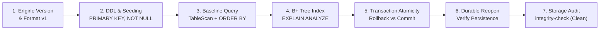

# KlyrDB Portfolio Demonstration

A reproducible, automated demonstration of KlyrDB v0.12.0 core engine capabilities:
- **Slotted-Page Tuple Storage:** 4096-byte pages with variable-length record indirection and CRC-32 integrity.
- **Relational Constraints:** Single-column `PRIMARY KEY`, `NOT NULL`, and `UNIQUE` indexes.
- **Persistent B+ Tree Indexing:** Balanced secondary index traversal over integer keys.
- **Cost-Based Query Planning:** Physical access path selection (`IndexRangeScan`) and execution telemetry (`EXPLAIN ANALYZE`).
- **Transaction Rollback Atomicity:** Multi-page rollback safety via before-image log records.
- **Durable Commit & Persistence:** Cross-session state persistence across independent process invocations.
- **Online Diagnostics:** Real-time storage and relational integrity auditing (`integrity-check`).

---

## Prerequisites

- **Operating System:** Windows 10 / 11 x64
- **Shell:** Windows PowerShell 5.1+ or PowerShell Core 7+
- **Database CLI Executable:** Compiled `klyrdb.exe` (found automatically in `build/Release`, `build_audit_release/Release`, or `dist/bin/klyrdb.exe`)
- **(Optional) C++20 SDK Build:** CMake 3.20+ and MSVC 19.51+ (VS 2022/2026 BuildTools)

---

## Quick-Start: Automated PowerShell Runner

The automated runner script creates an isolated temporary directory, executes the full demo workflow, verifies exit codes at every step, and cleans up automatically:

```powershell
powershell -ExecutionPolicy Bypass -File demos/portfolio/run_demo.ps1
```

To preserve the generated database for manual inspection after the demo finishes:

```powershell
powershell -ExecutionPolicy Bypass -File demos/portfolio/run_demo.ps1 -KeepDatabase
```

---

## Demonstration Workflow Steps

The demonstration walks through 7 sequential phases:



1. **Engine Identification (`klyrdb.exe version`):**
   Displays semantic engine version (`v0.12.0`), storage format version (`1`), and backup format version (`1`).
2. **Schema Definition & Seeding:**
   Creates table `products (sku INTEGER PRIMARY KEY, name TEXT NOT NULL, price INTEGER, in_stock INTEGER)` and seeds 3 inventory records.
3. **Filtered & Sorted Query Execution:**
   Executes `SELECT sku, name, price, in_stock FROM products WHERE price <= 150 ORDER BY price ASC;` showing tabular formatting and row counting.
4. **B+ Tree Indexing & Cost-Based Optimizer (`EXPLAIN ANALYZE`):**
   Creates secondary index `CREATE INDEX idx_price ON products(price);`.
   Executes `EXPLAIN` and `EXPLAIN ANALYZE`, displaying the chosen physical plan (`Index Range Scan`, estimated cost `0.90`), rows examined, planning time, and microsecond execution time.
5. **Transaction Rollback & Durable Commit:**
   - Starts explicit transaction (`BEGIN;`), inserts uncommitted row `999 ('Temporary Prototype')`, queries it inside the transaction, and executes `ROLLBACK;`.
   - Re-queries record `999` post-rollback, confirming **0 rows returned**.
   - Starts second transaction (`BEGIN;`), inserts valid row `104 ('4K UltraSharp Monitor')`, and executes `COMMIT;`.
6. **Cross-Session Storage Persistence:**
   Spawns an independent `klyrdb.exe` process to reopen the database from disk and confirms all 4 committed rows are present.
7. **Storage & Relational Integrity Audit (`integrity-check`):**
   Performs a non-destructive offline audit validating page CRC-32 checksums, slotted-page slot directories, B+ tree leaf ordering, and foreign key referential integrity. Reports `HEALTHY (CLEAN)` with 0 errors and 0 warnings.

---

## C++20 SDK Demonstration (`demo_sdk.cpp`)

To demonstrate KlyrDB's programmatic interface beyond the SQL CLI, build and run `demo_sdk.cpp`:

```powershell
# Configure and build against installed KlyrDB package
cmake -B build_demo_sdk -S demos/portfolio -DCMAKE_PREFIX_PATH="C:/opt/klyrdb"
cmake --build build_demo_sdk --config Release

# Run compiled executable
.\build_demo_sdk\Release\demo_sdk.exe
```

### Highlights Demonstrated in C++20 SDK:
- **RAII Resource Management:** `klyrdb::Database::open()`, `klyrdb::Connection`, `klyrdb::TransactionGuard`.
- **Automatic Rollback Safety:** `TransactionGuard` destructor aborts and rolls back mutations on exception or uncommitted scope exit.
- **Modern Result Semantics:** `klyrdb::Result<T>` with rich `StatusCode` diagnostics.
- **Programmatic Integrity Check:** Calling `db->integrity_check()` directly from application code.

---

## Safety & Cleanup Guarantee

- The demo runner creates a disposable database under `$env:TEMP\klyrdb_portfolio_demo_<guid>\`.
- No user databases or existing project files are ever modified or removed.
- All temporary artifacts (`.kdb`, `.kdb.wal`, `.kdb.lock`) are deleted immediately on completion unless `-KeepDatabase` is explicitly specified.
