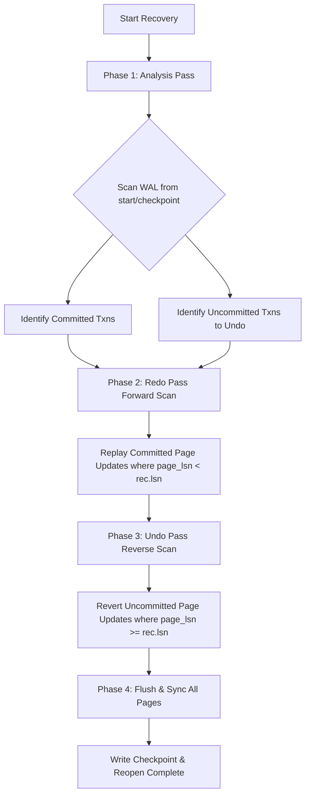

# KlyrDB — Crash Recovery Engine Specification

## 1. Overview & Recovery Goals

The KlyrDB Crash Recovery Engine (`RecoveryManager`) reconstructs a consistent database state after an unclean shutdown, process termination, hardware failure, or power cut.

The recovery algorithm is inspired by the classical ARIES recovery method, adapted for physiological page-image logging. It satisfies three core invariants:

1. **Redo of Committed Transactions (Durability):** All page modifications made by committed transactions that were not flushed to the database file before the crash are reconstructed.
2. **Undo of Uncommitted Transactions (Atomicity):** All modifications made by active or aborted transactions that reached disk (due to buffer pool clock eviction or partial flushes) are reverted to their before-images.
3. **Idempotence & Restartability:** If a crash occurs *during* the recovery process itself, re-running recovery produces the exact same consistent database state without compounding errors or duplicating data.

---

## 2. The Three-Phase Recovery Algorithm



### 2.1 Phase 1: Analysis Pass
- The log is scanned sequentially starting from the active checkpoint boundary (`min_required_lsn` or `checkpoint_lsn` stored in Page 0 metadata, falling back to LSN 1 only if uncheckpointed).
- Analyzes log records within the recovery horizon to determine transaction status:
  - `LogRecordType::Commit` records populate `committed_txns`.
  - `LogRecordType::Abort` records populate `aborted_txns`.
  - Any transaction referenced in a `Begin`, `PageUpdate`, or `PageAlloc` record that is **not** present in `committed_txns` is added to `txns_to_undo`.

### 2.2 Phase 2: Redo Pass (Forward Scan)
- Scans forward from the checkpoint boundary to the end of the log.
- For each `PageUpdate` or `PageAlloc` record belonging to a transaction in `committed_txns`:
  1. Ensures the underlying page file has enough pages allocated.
  2. Fetches the page through `BufferPoolManager`.
  3. Checks the page's current LSN:
     ```cpp
     if (guard->page_lsn() < rec.lsn) {
         guard->load_from_raw(rec.after_image);
         guard->set_page_lsn(rec.lsn);
         guard.mark_dirty();
         stats.pages_redone++;
     }
     ```
  4. If `guard->page_lsn() >= rec.lsn`, the modification is already present on disk and is skipped (preserving idempotence and avoiding unnecessary page writes).

### 2.3 Phase 3: Undo Pass (Reverse Scan)
- Scans backward from the end of the WAL toward the checkpoint boundary.
- For each `PageUpdate` or `PageAlloc` record belonging to a transaction in `txns_to_undo`:
  1. Fetches the target page through `BufferPoolManager`.
  2. Checks if the uncommitted change reached the page:
     ```cpp
     if (guard->page_lsn() >= rec.lsn) {
         guard->load_from_raw(rec.before_image);
         guard->set_page_lsn(rec.prev_lsn);
         guard.mark_dirty();
         stats.pages_undone++;
     }
     ```
  3. Reverts the page to the recorded before-image, restoring the previous LSN.

### 2.4 Phase 4: Flush and Sync
1. Flushes all pages in the buffer pool to the database file: `bpm_.flush_all_pages()`.
2. Issues physical hardware synchronization: `bpm_.page_file().sync()`.
3. Reloads Page 0 metadata in `PageFile` if Page 0 was affected.
4. Appends a new `Checkpoint` record to the WAL, updates Page 0 Checkpoint LSN, and safely truncates prior records.

---

## 3. Checkpoint-Accelerated Recovery (Phase 9)

In earlier phases, recovery had to parse the WAL from offset 0 / LSN 1 on every startup. In Phase 9, startup recovery is accelerated by leveraging checkpoint boundaries:

1. **Page 0 Checkpoint LSN Lookup:** At startup, `RecoveryManager` reads the persistent checkpoint LSN stored at byte offset 40 of Page 0.
2. **Boundary Validation:** It reads the checkpoint record from the WAL to extract the `min_required_lsn` (accounting for any transactions that were active at the checkpoint time).
3. **Targeted Scanning:** Scanning starts at `start_lsn = std::min(checkpoint_lsn, min_required_lsn)`. All prior log records correspond to changes already guaranteed durable in the database file and are skipped.
4. **Telemetry & Observability:** `RecoveryStats` tracks complete operational telemetry:
   - `records_scanned`: Number of log records actually evaluated during recovery.
   - `duration_ms`: Wall-clock recovery time in milliseconds.
   - `pages_redone` and `pages_undone`: Specific physical page corrections.
   - `wal_size_before` and `wal_size_after`: Byte sizes before and after recovery.

---

## 4. Handling Partial & Torn WAL Writes

During sudden crashes, the tail of the WAL file may contain an incomplete or partially written record.
- `WriteAheadLog::read_all_records()` verifies the 25-byte record header and checks the trailing CRC-32 checksum of every record.
- If a record is truncated or has an invalid checksum at the log tail, the parser stops reading and treats the incomplete tail as uncommitted crash residue, preventing corruption.
- During recovery, any uncommitted partial transaction is undone.

---

## 5. Staged Crash Recovery in Physical Restore (Phase 10)

When a physical backup is restored (`RestoreManager::restore`) and contains an active WAL component:
1. **Isolated Staging Area:** Components (`data.kdb` and `wal.log`) are extracted to `<dest_path>.restore_tmp.<pid>.<timestamp>/`.
2. **Automated Recovery Replay:** If `options.run_recovery` is enabled (default), `RecoveryManager` executes on the staged files before touching the real destination database.
3. **Point-in-Time Consistency:** Analysis, Redo, and Undo passes run over the WAL, reconstructing committed writes and rolling back transactions that were in-flight at snapshot time.
4. **Post-Recovery Verification:** `IntegrityChecker` inspects Page 0 geometry, slotted records, and relational catalogs on the staged database.
5. **Atomic Publication:** The verified database is atomically swapped into place via filesystem rename, guaranteeing that failed restores never corrupt pre-existing target databases.
