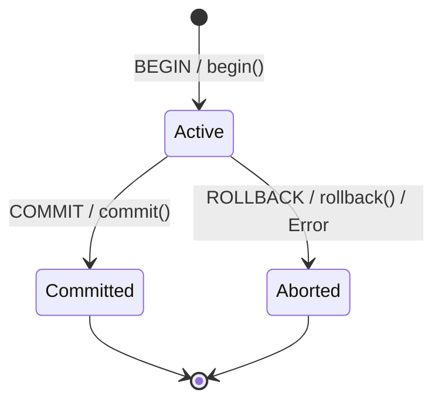

# KlyrDB — Transaction Subsystem Specification

## 1. Concurrency Model & Lifecycle

KlyrDB implements a single-writer, strict transaction model designed for embedded relational database systems. All write mutations operate within an explicit or implicit transaction context.

### 1.1 Transaction States

A transaction transitions through three explicit states during its lifetime:



- **`Active`:** The transaction is executing SQL statements or storage mutations. Changes are staged in memory (and logged to WAL).
- **`Committed`:** The transaction has successfully recorded a `Commit` record durably flushed to the WAL. Its changes are permanent.
- **`Aborted`:** The transaction was canceled via `ROLLBACK` or an error. All changes have been restored to their before-images.

---

## 2. Page Modification Protocol

To ensure both atomic rollback and write-ahead durability, page modifications adhere to a strict protocol managed by `TransactionManager` and `BufferPoolManager`:

### 2.1 Before-Image Capture
1. When a page is first pinned for modification under an active transaction, `BufferPoolManager` captures an in-memory snapshot of the page (the **before-image**) in the frame metadata (`frame.before_image`).
2. The frame's `has_before_image` flag is set to `true`.

### 2.2 In-Flight Logging & Update
1. The caller mutates page contents (e.g., slotted-page record insertion, deletion, or B+ tree reorganization) and calls `guard.mark_dirty()`.
2. `PageGuard::mark_dirty()` invokes `BufferPoolManager::notify_page_modified(page_id)`.
3. If an active transaction exists, `BufferPoolManager` calls `TransactionManager::log_page_update(txn, page_id, before_image, page)`:
   - Appends a `PageUpdate` log record containing both `before_image` and `modified_page` to the WAL.
   - Updates `txn->prev_lsn()` and sets `modified_page.set_page_lsn(lsn)`.
   - Records the change in `txn->page_changes()` for potential rollback.
   - Updates `frame.before_image` to the current state for subsequent delta tracking.

---

## 3. Transaction Rollback

When a user executes `ROLLBACK` or an implicit statement fails:

1. **State Transition:** Transaction state is marked `rolling_back = true` to prevent recursive change-logging during undo.
2. **Reverse Order Undo:** The transaction iterates through its `page_changes()` list in **reverse chronological order**:
   ```cpp
   for (auto it = changes.rbegin(); it != changes.rend(); ++it) {
       auto guard = bpm.fetch_page_guard(it->page_id);
       guard->load_from_raw(it->before_image.raw_data());
       guard->set_page_lsn(it->before_image.page_lsn());
       guard.mark_dirty();
   }
   ```
3. **Log Abort Record:** An `Abort` record is appended to the WAL and flushed.
4. **Disarm & Finalize:** State is marked `TransactionState::Aborted` and the transaction is unregistered from active transactions.

---

## 4. SQL Integration & Safety Guarantees

### 4.1 Explicit Transactions
- Users control multi-statement transactions via `BEGIN;`, `COMMIT;`, and `ROLLBACK;`.
- DDL statements (`CREATE TABLE`, `CREATE INDEX`, `DROP TABLE`, `DROP INDEX`) are disallowed inside explicit transactions to avoid complex catalog-locking scenarios. Attempting DDL inside an active transaction returns `StatusCode::FeatureNotSupported`.

### 4.2 Implicit Statement Transactions
- Single statements executed outside a `BEGIN` block (`INSERT`, `UPDATE`, `DELETE`) are automatically wrapped in an implicit transaction:
  1. `begin()` creates an internal transaction.
  2. The mutation executes.
  3. If successful, `commit()` is invoked and flushed.
  4. If execution fails (e.g., duplicate key, constraint violation, malformed data), `rollback()` is automatically invoked, restoring the database to its pre-statement state.
